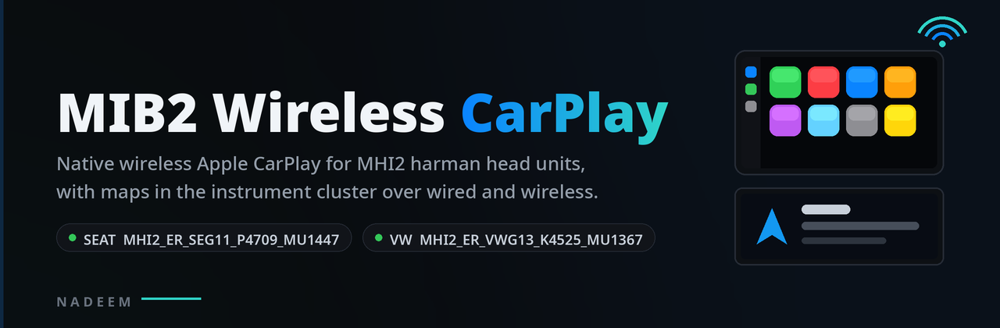

  

  
  
  

Native wireless Apple CarPlay for MIB2 (MHI2) harman head units, with
navigation maps in the instrument cluster — over wired and wireless.

---

## What's new in this pre-release

- **Touch fixed** — works cleanly alongside the factory interface and the car's own functions.
- **Installer reworked** — safer checks, cleaner install and uninstall.
- **VW support added** — first VW train: `MHI2_ER_VWG13_K4525_MU1367`.

## Supported firmware

| Brand | Firmware train | Cluster map |
|---|---|---|
| SEAT | `MHI2_ER_SEG11_P4709_MU1447` | 1010 × 376 (10.5-inch)|
| VW | `MHI2_ER_VWG13_K4525_MU1367` | 800 × 480 (12.3-inch, 791) |

> **Warning — only these two trains are supported.** Every other firmware — including AUDI and SKODA MU1433 / MU1440 and any other VW or SEAT build — uses different HMI class layouts. Do not install on it.

## Features

- **Native wireless CarPlay** over the unit's own WLAN hotspot — no cable.
- **Cluster map card** — CarPlay navigation in the instrument cluster, over wired **and** wireless, at each cluster's native resolution (table above).
- **Guidance data** on the cluster card: manoeuvre, distance, street.
- **Touch forwarding** to the phone, correctly scaled.
- **Runtime switches** under `/mnt/persist` — disable individual parts without uninstalling.

## Install

Two routes, one installer — it checks everything before the first write:

- **SD card (SWDL)** — copy the package to a FAT32 card, run it from the software-update menu.
- **Manual over SSH** — stage the same tree on the unit and run `install.sh`.

Step by step: [docs/installation.md](docs/installation.md)
Required once per phone after install: [docs/pairing.md](docs/pairing.md)

## Documentation

| Page | Covers |
|---|---|
| [docs/installation.md](docs/installation.md) | SWDL and SSH install, step by step |
| [docs/pairing.md](docs/pairing.md) | First-time pairing, required once per phone |
| [docs/operation.md](docs/operation.md) | Runtime controls, logs and switches |
| [docs/rollback.md](docs/rollback.md) | Uninstall and full factory restore |

## Credits

Original wireless engine and Altscreen maps scripts by **[omonob](https://github.com/omonob/VW-MHI2-Wireless-Carplay-Maps)**.
